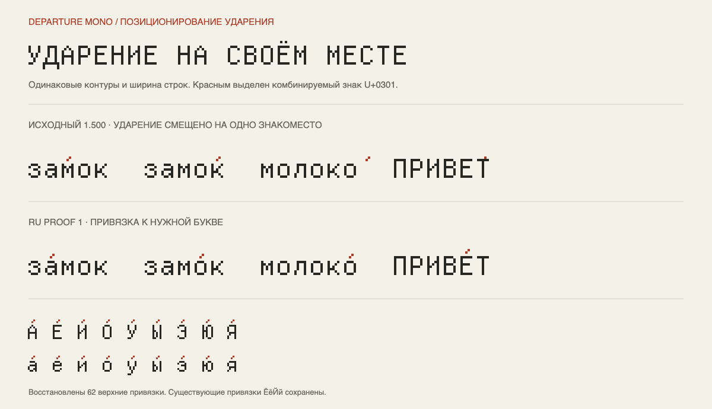

# Departure Mono RU

An unofficial fork of [Departure Mono](https://github.com/rektdeckard/departure-mono)
by [Helena Zhang](https://helenazhang.com), with corrected Russian combining-mark
positioning, reproducible font builds, and typography research.

**Departure Mono already includes Cyrillic.** This fork fixes the placement of
stress marks on existing Russian letters. The original pixel outlines and
monospaced character widths are preserved.

## What changed

In upstream 1.500, combining acute accents (`U+0301`) on most Russian letters
appear one character cell too far to the right. For example, the stress mark in
`за́мок` appears above `м`, and the final mark in `молоко́` appears after the word.

**Version 1.501 / RU proof 1** makes the following changes:

- Adds missing top anchors to **62 existing Russian letters** in the Cyrillic
  GPOS mark-to-base lookup. The existing anchors for `ЁёЙй` are retained.
- Positions stress marks above their base letters with a one-module vertical
  gap. Combining marks do not add a character cell to a shaped word.
- Keeps all **1,186 original glyph outlines**, character mappings, glyph order,
  advance widths, GSUB features, and vertical metrics.
- Uses the separate family name **Departure Mono RU** and PostScript name
  **DepartureMonoRU-Regular**, so the proof can be installed beside the original.
- Includes OTF, WOFF, and WOFF2 builds, regression checks, visual specimens,
  and an English-language [Russian typography study](docs/CYRILLIC-RU.md).

The new anchors apply to the existing top-mark class, including marks other
than acute. Russian stress marks are the primary tested use case. The change
does not add new Cyrillic letters or claim authorship of the original Cyrillic
design. See the [font change log](fonts/departure-mono-ru/FONTLOG.md).



The upper row shows upstream 1.500; the lower row shows RU proof 1. Combining
acute accents are highlighted in red.

## Download and install

Download the font files from [fonts/departure-mono-ru](fonts/departure-mono-ru/):

| File | Use |
| --- | --- |
| [DepartureMonoRU-Regular.otf](https://github.com/miolamio/departure-mono-ru/raw/refs/heads/main/fonts/departure-mono-ru/DepartureMonoRU-Regular.otf) | Desktop installation |
| [DepartureMonoRU-Regular.woff2](https://github.com/miolamio/departure-mono-ru/raw/refs/heads/main/fonts/departure-mono-ru/DepartureMonoRU-Regular.woff2) | Web font |
| [DepartureMonoRU-Regular.woff](https://github.com/miolamio/departure-mono-ru/raw/refs/heads/main/fonts/departure-mono-ru/DepartureMonoRU-Regular.woff) | Additional web format |

Install the OTF through your operating system's font manager, then select
**Departure Mono RU** in your application. Keep [OFL.txt](fonts/departure-mono-ru/OFL.txt)
with the font files when redistributing them.

For web usage, see the [CSS example](fonts/departure-mono-ru/README.md#web-usage).
Start with a font size of **11, 22, 33, or 44 px** and `letter-spacing: 0`.

Existing Homebrew and Nix packages named `departure-mono` install the original
upstream font; they do not install this fork.

## Build and verify

Install [uv](https://docs.astral.sh/uv/), then run from the repository root:

```sh
uv run scripts/font_ru.py build
uv run scripts/font_ru.py check
uv run scripts/font_ru.py proof
```

Dependencies are pinned in the script. The build checks the SHA-256 of the
upstream OTF before applying the patch and generates all three formats.
`check` also verifies that the checked-in artifacts match a fresh build.

The repository contains the upstream website and compiled font assets, not the
author's Glyphs source project. This is a reproducible patch of the compiled
1.500 OTF, rather than a reconstruction of the original font sources.

## Validation and scope

Automated checks cover:

- Reproduction of the upstream stress-mark bug and corrected Russian mark placement.
- All 66 Russian letters, the 50-unit contour grid, and the 350-unit advance width.
- Preservation of all 1,186 outlines and existing font metrics.
- Equivalent rendering of precomposed and decomposed `ЁёЙй`.
- Unchanged ordinary Russian, Latin, Greek, and selected OpenType-feature samples.
- Deterministic OTF, WOFF, and WOFF2 output and the bundled OFL license.

All three formats were also checked in **Chromium 156 on macOS** at
11/22/33/44 px, including pixel positions and shaped word widths.
Safari/CoreText, Firefox, Windows applications, small caps with stress marks,
and arbitrary stacked diacritics have not been validated. This remains an
experimental proof.

| Material | Link |
| --- | --- |
| Design research, geometry, sources, and implementation notes | [Typography study](docs/CYRILLIC-RU.md) |
| Russian alphabet, Latin comparisons, difficult forms, and text sizes | [Specimen PNG](docs/proofs/russian-specimen.png) · [SVG](docs/proofs/russian-specimen.svg) |
| Stress-mark comparison | [Before/after SVG](docs/proofs/stress-before-after.svg) |
| Actual browser rendering | [Browser screenshot](docs/proofs/browser-stress.png) |
| Measurements and shaping positions | [Audit JSON](docs/proofs/audit.json) |

Specimen text and captions are in Russian to support review of the target
script. Documentation and change descriptions are in English.

## Upstream website

Departure Mono is a monospaced pixel font inspired by early command-line and
graphical interfaces, late-1990s and early-2000s pixel fonts, and science fiction.
The original project and releases are available at
[rektdeckard/departure-mono](https://github.com/rektdeckard/departure-mono).

The inherited Solid/Vite site still uses the original font assets and links.
Its DreamHost deployment workflows are restricted to the upstream repository.
This fork publishes font files and research; it does not deploy a website.

## Credits and licenses

- **Original typeface and Cyrillic design:** Helena Zhang. Original credits and
  history are retained in [public/assets/README.md](public/assets/README.md).
- **Russian mark-positioning patch, build tools, and research:** this fork,
  maintained by [Anton Vdovichenko](https://github.com/miolamio).
- **Font, including the modified builds:** [SIL Open Font License 1.1](fonts/departure-mono-ru/OFL.txt).
- **Website and repository code:** [MIT](LICENSE), with original website credits
  to Helena Zhang and Tobias Fried.

This is an independent fork, not an official release or endorsement by the
original authors.
